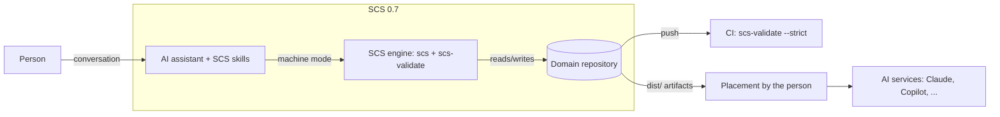

# 1. System context

## Purpose

0.7.0 makes an AI assistant the intended way to create, maintain, validate, version, and compile
SCS bundles. A person produces approved, versioned context through conversation without
learning the format. The spec is the authority, the validator is the gate, and a named person
approves every version (RFC 0002 Summary).

## Boundary

SCS 0.7 starts at a conversation and ends at a validated, versioned bundle and its compiled
artifact in a local Domain repository.

Inside: Agent Skills, the engine (CLI + validator + compiler), schemas, the Domain repository
layout and its generated `AGENTS.md` and CI workflow, the spec text, and a non-normative
placement guide.

Outside (RFC §1, §10): placing artifacts into AI services, multi-user review and approval
workflows, registries, hosting, runtime serving or streaming of context (SCP's job). The agent
says so when asked.

## Actors

| Actor | Role in 0.7 |
|---|---|
| Individual developer | Owns a personal Domain; approves their own versions |
| Organization approver (e.g. quality manager) | Answers intake, decides review findings, approves versions |
| AI assistant running the skills | Runs intake, drafts, reviews, explains; calls the engine; never approves |
| Engine (`scs`, `scs-validate`) | The only deterministic behavior: scaffold, validate, version, compile, diff |
| CI | Re-runs strict validation on every push |
| AI service | Consumes a compiled artifact the person placed; not part of SCS |

## Constraints

- **Additive.** No breaking changes to SCDs or bundles (RFC header). Opening SCD item schemas for
  `derived_from` must not invalidate 0.6 content.
- **Single maintainer.** Decisions in section 7 are the maintainer's; no comment periods.
- **Distribution.** Skills in hosted chat sandboxes need `pip install` to work, which needs both
  packages on PyPI (ROADMAP WS8; RFC UQ3).
- **Toolchain.** Python 3.11 and 3.12; ruff, black, mypy (validator) gates in CI; schemas vendored
  into the validator package and checked by `sync_schemas.py --check`.
- **Regulated users.** Every SCD item should trace to an intake answer or source document, and
  every version to a named person. The CDMO profile must hold up to an audit.

## Starting point

As of 2026-10-25 (`survey/status-and-dependencies.md`): hardening is code-complete with ISS-045
uncommitted; everything from ISS-048 onward is not started; `spec/0.7` is a copy of 0.6 with
only the digest text updated; PyPI has no usable toolchain.
