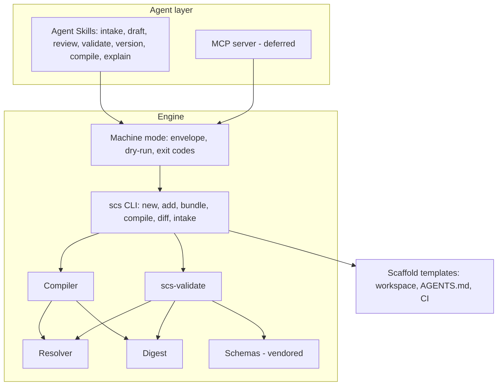

# 2. Component model

## Layering rule

Deterministic behavior lives in the engine. Skills carry judgment (intake, drafting, review,
explanation) and call the engine for anything that validates, versions, compiles, scaffolds, or
diffs. A skill never reimplements an engine operation (RFC §2). Where a skill must write a file
the engine has no command for, decision D-08 governs.

## Components

| Component | Responsibility | Must not | As-built | Work package |
|---|---|---|---|---|
| `scs` CLI | Scaffold Domain repos and workspaces; add SCDs/bundles; version; compile; diff; pin; write intake records | Prompt in machine mode; infer human values; place artifacts | Commands exist without machine mode; no repo scaffold, diff, pin, intake | WP-05, WP-06, WP-03, WP-08, WP-07 |
| Machine mode | One JSON envelope on stdout, `--dry-run` change lists, RFC exit codes, diagnostic codes | Mix prose into stdout | Not built | WP-05 |
| Compiler | Resolved tree to deterministic runtime artifact; verify digests; write `dist/` | Emit `derived_from`; compile on digest mismatch | Built; digest verification uncommitted; skips verification when tree has a DRAFT | WP-05, WP-14 |
| `scs-validate` | Single source of validity: schemas, rules, tree, digests, repository layout | Validate reserved directories | Built; no repo mode, no codes, no intake/`derived_from` | WP-04, WP-07 |
| Resolver | Index ids in a workspace; resolve imports and SCDs | Index reserved directories; silently pick between duplicate ids | Indexes reserved dirs; unpinned imports can resolve to snapshots | WP-14, WP-04 |
| Digest | Canonical content digest; manifest lookup; verification | | Built, uncommitted | WP-00 |
| Schemas | SCD tiers, bundle, runtime artifact, domain manifest, intake (new), version manifest (new) | | No intake or manifest schema; SCD items closed | WP-04, WP-07 |
| Scaffold templates | Repo layout, `.scs/config`, `AGENTS.md` + pointer, CI workflow, personal profile | | Single-workspace scaffold only | WP-03 |
| Agent Skills | Conversation: intake, draft, review, explain; orchestrate engine calls with confirmation | Write outside the Domain repo; approve; pass `--force`/`--no-validate`/`--allow-draft` unasked | Legacy plugins only (pre-0.6 model, not reusable as procedures) | WP-10 |
| Spec text | Normative definitions, including the agent interface | Contradict RFC 0002 | Mostly 0.6 text; several contradictions | WP-02a, WP-02b |
| Placement guide | Non-normative: where artifacts go per AI service | | Not started | WP-09 |
| MCP server | Thin stdio adapter over machine mode | Add behavior | Not started; deferred | WP-12 |
| Release | PyPI packages, GitHub releases, docs site | | PyPI has `scs-tools` 0.1.0 only | WP-11a, WP-11rc, WP-11 |

## Coupling to remove

- `scs bundle version` and `scs compile` shell out to `python -m scs_validator` and parse text
  with regexes (`bundle.py:472-488`, `compile.py:60-78`). Machine mode needs structured
  validation results, so both call the validator in-process (D-37, WP-05).
- CLI and validator derive bundle names from ids slightly differently (`bundle.py:495-500` vs
  `digest.py`). One shared function (WP-04).
