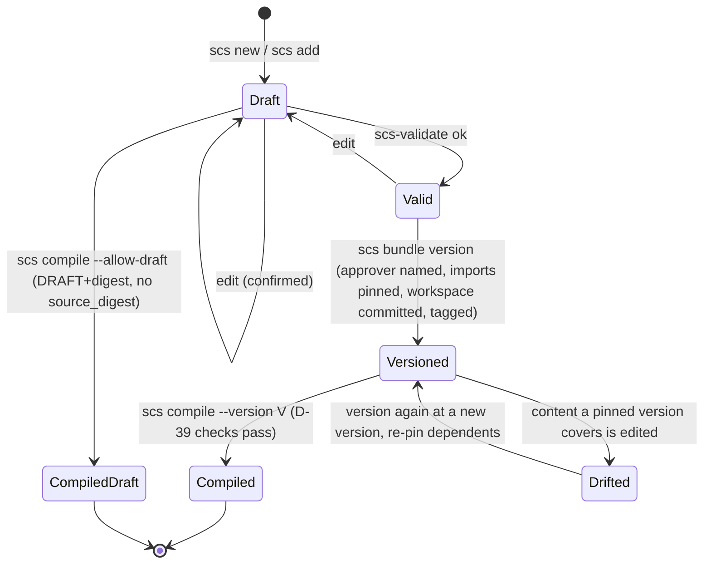

# 5. Lifecycle

## Integrity model (decided 2026-10-25)

**The git tag is the record of a version** (D-39). A version of a bundle is the tag
`<workspace>/<bundle-name>-v<version>` on a commit that holds the whole workspace directory
except `dist/` (D-40). The manifest at that tag records the approver, the validation result, and
the `content_digest`.

Two RFC promises follow from this:

- **Verifiably immutable.** The digest recomputed from the tagged content must equal the tagged
  manifest's `content_digest`. Working-tree copies of manifests and snapshots must equal their
  tagged copies. Editing either is detected.
- **Rebuildable from the tag.** Everything the compiler reads is in the tagged commit (table
  below), so compiling at a checkout of the tag, with the manifest's `tools_version`, gives an
  artifact with the same `source_digest` and the same content as the original, apart from fields
  runtime-artifact §3.5 declares variable.

**Boundary.** Git allows a tag to be deleted and recreated by anyone with write access. SCS
detects change that was not recorded as a new version. It does not defend against someone who
rewrites both the content and the tag. Signed tags are out of 0.7; protecting tags on the remote
is the adopter's job, and the spec says so.

### Compiler inputs

| Input | In the tagged commit? |
|---|---|
| Bundle snapshot and manifest | Yes |
| SCDs of the bundle and of its imports in the same workspace | Yes (whole workspace) |
| Imported concept bundles' snapshots and manifests | Yes |
| `.scs/config`, `ontology/domain-manifest.yaml`, `intake.yaml` | Yes |
| `sources/` | No: ignored by default (D-59); not a compiler input |
| Meta bundle (`bundle:meta:0.6.0`) | No: packaged with the tools; fixed by `tools_version` in the manifest |
| Schemas and rules | No: packaged with the tools; fixed by `tools_version` |

## Bundle states

After `bundle version`, the working bundle file stays `DRAFT` (D-52); the released copy is the
snapshot, and the record is the tag. A released version is compiled with `scs compile --version V`
(D-57). Editing a root's SCDs after versioning is normal work toward its next version; nothing
reports it until the next version. "Valid" is not persisted. "Drifted" is detected by D-39
check 3, not stored.

## What validation verifies (D-39)

1. **Every version tag** in the repository: the digest recomputed from the tagged content equals
   the tagged manifest's `content_digest`, and each pinned import's manifest at that commit equals
   the import's own tagged manifest. Root bundles are covered here. A workspace-qualified version
   tag with no manifest at the tag is an error (`VERSION_MANIFEST_MISSING`); a manifest carrying
   `content_digest` with no qualified tag is an error (`VERSION_TAG_MISSING`).
2. **Working copies** of versions still in use (pinned by a working bundle, or the latest version
   of a bundle whose working file exists): the working manifest and snapshot equal their tagged
   copies by git blob id (`MANIFEST_ALTERED`). A removed bundle's versions are history, still
   covered by check 1. The scaffold's `.gitattributes` sets `* text eol=lf` so checkouts compare
   cleanly.
3. **Drift**: each pinned import of a working bundle matches its tagged content
   (`CONTENT_DIGEST_MISMATCH`, naming the changed files and the bundles to version again).

Versions without a workspace-qualified tag (pre-0.7) are history: not verified, not reported
(D-54). `scs-validate --verify-version <tag>` checks a single version on request.

All three checks read tags, so repository mode on a shallow clone is an error
(`GIT_HISTORY_INCOMPLETE`); the generated CI fetches full history and tags.

## Transition guards

| Transition | Guard |
|---|---|
| Draft to Versioned | Content validation passes, unless `--no-validate` was requested by the user (D-53). Integrity checks always run: every import is pinned (D-14) and matches its tag. Approver named by the user (D-13). Version does not exist (D-15). Git present (D-38). |
| Versioned to Compiled | D-39 checks pass for the compiled tree, including when the root is DRAFT (D-16). No `source_digest` without a verified digest (D-18). No flag bypasses a failed check. |
| Resolution | Unpinned import resolves to the working file; pinned to the snapshot (D-17). Nothing under `plan/`, `test-plan/`, `qa/` is indexed. |

## Versioning order and approval

Bottom-up: concept bundles first, then the root, re-pinning as each concept is versioned. Before
asking for confirmation, the version skill shows a cascade plan listing every snapshot,
manifest, pin, commit, and tag. One confirmation that names the approver covers the cascade
(D-44). The skill then runs each step's `--dry-run` and stops if a result differs from the plan.

The version commit's author is the approver; its committer and the annotated tag's tagger are the
fixed identity `scs-tools <noreply@scs.invalid>` (D-55, D-58). Neither is read from the
environment, and the engine overrides signing, hooks, and line-ending settings for its own commit
and tag. The commit covers only the workspace (D-40 implementation note).

## Workspace and repository lifecycle

1. `scs new domain`: create the repo, Domain workspace, `AGENTS.md`, CI, `.gitignore`
   (`sources/`), `.gitattributes`; git init and an initial commit with the D-55 identity (in
   `changes`).
2. Intake for the Domain; `intake.yaml` written via `scs intake`.
3. Draft, review, validate, version, compile the Domain.
4. `scs new project` per Project; repeat 2 and 3.
5. Change: edit, diff, review, version again. Earlier versions stay as tags.

Migration from 0.6: move into the layout, then version each bundle once under 0.7 (D-54).

## Failure handling

Versioning writes a snapshot, a manifest, a commit, and a tag in sequence. On failure at any
step, the engine undoes what that run wrote and reports `ok: false` with the cause. The working
tree, index, and refs are left as they were before the run, and `changes` lists nothing (D-09).
