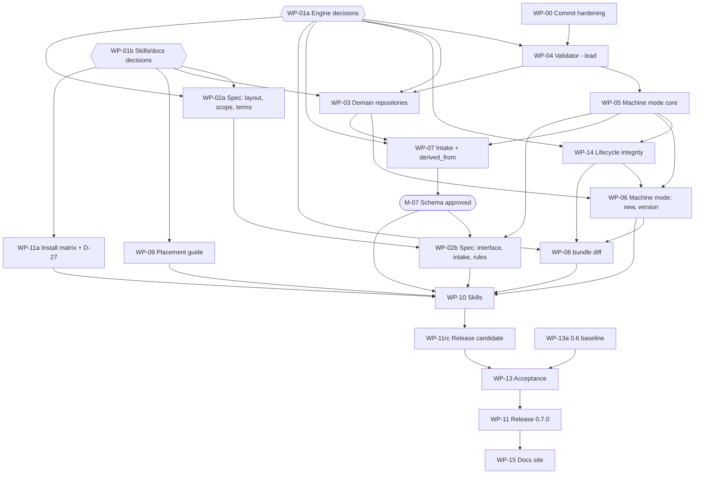

# 6. Work breakdown

Each work package (WP) lists the plan sections it implements, its dependencies, the files it
owns, and acceptance criteria. A WP is done when every criterion is met, CI is green (tests,
ruff, black, mypy, schema sync), and its migration notes are written to
`docs/migration.d/WP-nn.md` (assembled into `docs/MIGRATION-0.7.0.md` in WP-11rc). The
maintainer updates `ISSUES.md` when merging a WP; WPs do not edit it.

**Decision dependencies** come from the Blocks column in section 7, which is the single source.
**Machine-mode conformance** is defined once in section 4.

**Lead package.** WP-04 (validator) is built by one agent and inspected closely before any other
engine package starts, so the method and the plan are tested on a small, deterministic piece.
Documentation and decision packages may run alongside it.

## Dependency graph

**Critical path**: WP-00 and WP-01a (parallel) to WP-04, WP-05, WP-14, WP-06, WP-08, WP-10,
WP-11rc, WP-13, WP-11. Near-critical: WP-07 to M-07 to WP-02b to WP-10.

## Parallel groups

| Group | Packages | Waits for |
|---|---|---|
| 1 | WP-00, WP-01a, WP-01b, WP-13a | nothing |
| 2 | WP-09, WP-11a, WP-02a | WP-01b (WP-02a also WP-01a) |
| 3 | WP-04 (lead) | WP-00, WP-01a |
| 4 | WP-05, WP-03 | WP-04 (WP-03 also WP-01b) |
| 5 | WP-14, WP-07 | WP-05 (WP-07 also WP-03) |
| 6 | WP-06; M-07 then WP-02b | WP-14 + WP-03; WP-07 |
| 7 | WP-08 | WP-06 |
| 8 | WP-10 | WP-02b, WP-06, WP-08, WP-09, WP-11a, M-07 |
| 9 | WP-11rc, WP-13, WP-11, WP-15 | in sequence |

## File ownership

Two WPs never edit the same file at the same time. Where a file has several owners, they are
listed in order, and each starts after the previous one merges.

| Files | Owners, in order |
|---|---|
| Validator pipeline (`commands/validate.py`), rules, report, repo mode, `SKIP_DIRS`, D-03/D-04 checks, manifest schema, check registry, indexing (D-43) | WP-04 |
| Shared bundle-name function in `scd-validator/digest.py` and `commands/bundle.py` | WP-04 first, then the owners below |
| Validator checks added as modules through WP-04's check registry | WP-14 (integrity, `digest.py`, resolver selection), WP-07 (intake, `derived_from`) — separate modules, so parallel |
| `scs_tools/cli.py` and command discovery | WP-05. Later commands are discovered from `commands/`, so WP-06, WP-07, WP-08 do not edit `cli.py` |
| Envelope module, `compile.py`, `compiler.py`, `validate.py` (CLI), `scd write` | WP-05, then WP-14 (`compiler.py`: D-16, D-18) |
| `add.py` | WP-05, then WP-06 (D-13) |
| `commands/new.py`, `init.py`, `utils/files.py`, templates | WP-03, then WP-06 |
| `commands/bundle.py` | WP-05 (in-process validator), then WP-14 (naming, guards, commit), then WP-06 (machine mode, pin, add/remove commands, rollback) |
| `commands/diff.py` | WP-08 |
| `commands/intake.py`, intake schema, SCD item schemas | WP-07 |
| `schema/runtime/`, `schema/cli/` | WP-05 |
| `schema/diagnostics/codes.d/WP-nn.yaml` | each WP its own fragment; WP-04 owns the merge step and `codes.yaml` |
| `docs/migration.d/WP-nn.md` | each WP its own fragment |
| `pyproject.toml` (both) | WP-05 (mypy), then WP-11rc. WP-11a builds from a throwaway branch |
| `spec/0.7/` | WP-02a, then WP-02b |
| `skills/` | WP-10 |
| `docs/placement/` | WP-09 |

## Work packages

### WP-00 Commit hardening (ISS-045)
- **Sections**: 3, 5. **Depends**: none. **Owner**: maintainer.
- Commit the ISS-045 work as one commit and the RFC reservation amendment as another; push
  `0.7-dev`. Read the validator's `__version__` from package metadata. This commits the digest
  algorithm, which the integrity model keeps; WP-14 changes where verification reads from.
- **Accept**:
  - CI green on the pushed commit; `scs-validate --version` reports the package version.
  - Digest test vectors in `tests/digest/`, with expected digests computed independently of the
    implementation, cover: reordered YAML keys, changed comments and whitespace (same digest), one
    changed field value (different digest), non-ASCII text, a bundle with two pinned imports, SCD
    ordering by id.
  - `validation_passed: false` is recorded under `--no-validate`; `approval_status` reflects the
    actual run.
  - Regression tests for ISS-042, ISS-043 (two concept bundles at the same version keep separate
    manifests and tags), and ISS-044 exist and pass.

### WP-01a Engine decisions
- **Depends**: none. **Owner**: maintainer (not delegable).
- Decide section 7 A to D (D-39, D-40, D-53, D-54 already decided). Commit the implied RFC 0002
  amendment. Update ISS-048 and ROADMAP WS2 for the reserved names.
- **Accept**: every item in sections A to D has a recorded outcome; RFC amendment committed.

### WP-01b Skills, spec, and docs decisions
- **Depends**: none. **Owner**: maintainer.
- Decide section 7 E except D-27, whose per-client choice is a WP-11a output. Decide D-21, D-23,
  and D-31 first; WP-03 needs them.
- **Accept**: every item in section E except D-27 has a recorded outcome.

### WP-02a Spec: layout, scope, terminology
- **Sections**: 1, 3, 5. **Depends**: WP-01a, WP-01b (D-22).
- Domain repository layout replaces `bundle-format.md` §8; remove the rejected §14 extension;
  personal Domain in `terminology.md` §2.11/§3.4 and `core-model.md` §5.4; replace
  `governance-and-compliance.md` §8-9 agent role; the integrity model (section 5 of this plan) in
  `bundle-format.md` §7, including its stated boundary; "0.6.0" scope text updated; RFC links to
  `spec/0.7/`.
- **Accept**: `spec/0.7/rfc-0002-trace.md` lists every MUST and SHOULD in RFC 0002 sections 1, 4,
  9, 10, 11 (numbered) with the spec section that states it; `grep -rE 'spec/0\.6|0\.6\.0'
  spec/0.7 rfcs/RFC-0002*` returns only historical references, each listed in the trace file;
  maintainer signs off.

### WP-02b Spec: agent interface, intake, rules
- **Sections**: 4. **Depends**: WP-02a, WP-05, M-07.
- New `spec/0.7/agent-interface.md`: scope, machine mode and envelope, workspace selection,
  intake, confirmation rules, advisory review, placement boundary. `derived_from` (not compiled)
  in `runtime-artifact.md` and the tier docs. The diagnostic code table is generated from
  `codes.yaml` at docs build (WP-15), not committed.
- **Accept**: the trace file covers every MUST and SHOULD in RFC 0002 sections 2, 3, 5, 6, 7, 8,
  12, Schema Changes, and Validation Rules; maintainer signs off.

### WP-03 Domain repositories (ISS-048)
- **Sections**: 3, 5. **Depends**: WP-04, WP-01a (D-01, D-03 to D-06, D-33, D-59), WP-01b (D-21,
  D-31), section 7 G (D-60 to D-64, D-71, D-72). D-23 is superseded by D-61 and D-62.
- `scs new domain NAME` creates `NAME-context/` with `domain/`, `projects/`, `AGENTS.md` +
  `CLAUDE.md` pointer, CI workflow, git init; `scs new project` under `projects/`; templates chosen
  by ontology and workspace kind only (D-64): `--type` removed, the `personal` ontology added with
  boundaries as its only concept (D-61, D-62, D-72), no `--profile`, no `ontology: none`;
  `created_by` is `Name <email>` (placeholder provenance waits on D-71); ontology manifest at `ontology/`; `.scs/config` keys; `.gitignore` ignoring
  `sources/` (D-59) and leaving `dist/` to the user (version commits exclude `dist/` by pathspec);
  `.gitattributes` with `* text eol=lf`; an initial commit with the D-55 identity. The CI workflow
  checks out full history and tags (`fetch-depth: 0`).
- **Accept**:
  - `scs new domain x` creates `x-context/`; then `scs new project a`; then `scs-validate --strict`
    at the repo root exits 0; the generated workflow runs that same command with `fetch-depth: 0`
    and tags fetched (test).
  - Generated `AGENTS.md` contains the Domain name, the five operations, and an application-work
    exclusion; `CLAUDE.md` references `AGENTS.md` (test).
  - No `plan/`, `test-plan/`, `qa/` is created; `scs new domain plan` and a project named `qa`
    give `RESERVED_BUNDLE_NAME`.
  - `scs new project` outside a Domain repo gives `DOMAIN_WORKSPACE_MISSING`.
  - Each ontology (`sdlc`, `cdmo`, `mca`, `personal`) has a Domain and a Project scaffold test; a
    `personal` workspace has only the `prohibited` concept bundle. `--type` and `--profile` are
    gone (usage error).
  - The new repo has one commit (author and committer `scs-tools <noreply@scs.invalid>`), and
    `sources/` is ignored.

### WP-04 Validator (lead)
- **Sections**: 3, 4. **Depends**: WP-00, WP-01a (D-02, D-03, D-04, D-10, D-28, D-33, D-36, D-43,
  D-47).
- Check registry: the pipeline runs registered check modules, so later WPs add checks without
  editing `commands/validate.py`. Repository mode (workspace discovery, per-workspace report,
  worst exit code); reserved dirs skipped at workspace root only; reserved bundle names; duplicate
  ids; `CONFIG_NAME_MISMATCH`; legacy ontology location (info); version manifest schema (person
  identifier per D-28); `code` and `severity` per finding with `info` not affecting exit codes;
  `schema/validator/report-schema.json`; codes registry merge from fragments; shared bundle-name
  function; structured in-process API; a 0.7 rule set.
- **Accept**:
  - JSON output validates against the report schema; every diagnostic in the test corpus has a
    registered code (CI check).
  - Repo mode: tests for zero, one, and two Domain workspaces, and for reserved-dir content under
    `--strict` (no diagnostic).
  - The manifest schema rejects an empty or `role:` `approval.approved_by`; `content_digest` and
    `tools_version` stay optional in the schema (D-49 is checked in WP-14).
  - A workspace holding snapshots and manifests of two versions of a bundle has no `DUPLICATE_ID`.
  - An `info` diagnostic under `--strict` leaves exit 0.
  - A check module added in a test registers and runs without editing `commands/validate.py`.
  - Each new rule has a pass and a fail test.

### WP-05 Machine mode core (ISS-049, part 1)
- **Sections**: 4. **Depends**: WP-04, WP-01a (D-08, D-09, D-10, D-11, D-12, D-33, D-37, D-42,
  D-45, D-47, D-56).
- Envelope library and schema; command discovery; `--json` on `scs --version`, `validate`,
  `compile`, `add`, and (D-08 option 1) `scd write`; `--dry-run` where section 4 says; exit codes;
  workspace selection; compile to `dist/`; compile and versioning call the validator in-process;
  reserved names refused at `scs add`; mypy on scs-tools.
- **Accept**:
  - Machine-mode conformance for each command above.
  - One test per exit code 0 to 5.
  - `compile` writes `dist/<bundle-name>-<version>.yaml`; an output path outside the repo gives
    `OUTPUT_OUTSIDE_REPO`.
  - `scs add bundle plan` gives `RESERVED_BUNDLE_NAME`.
  - `scd write` reads stdin and writes nothing outside the repo.
  - No `scs` command opens a network connection (tests run under a socket-blocking fixture).
  - No subprocess call to the validator remains (grep test).

### WP-14 Lifecycle integrity
- **Sections**: 5. **Depends**: WP-05, WP-01a (D-01 to D-03, D-14 to D-19, D-38 to D-40, D-43,
  D-49, D-52 to D-58), section 7 G (D-66, D-70, D-71).
- Implement the integrity model in section 5: the D-39 checks as validator check modules
  (reading tagged content and manifests from git), `--verify-version`; resolver selection (D-17);
  compiler verification for DRAFT roots and no `source_digest` without a verified digest (D-16,
  D-18); `scs compile --version V` (D-57); manifest format by tag form (D-49); versioning guards (D-14, D-15, D-38, D-53); snapshot naming (D-43); whole-workspace
  version commit limited to the workspace pathspec, with the D-55/D-58 identity, annotated tag,
  and git settings overridden (D-40, D-58); actionable drift diagnostic (D-19).
- **Accept**, one test each:
  - Versioning a root with a DRAFT or unpinned import gives `VERSION_IMPORT_NOT_PINNED`, with and
    without `--no-validate`.
  - `--no-validate` on a root whose pinned import has drifted gives `CONTENT_DIGEST_MISMATCH`.
  - Versioning at an existing version gives `VERSION_EXISTS`; there is no `--force` or `--no-git`.
  - The version commit contains the whole workspace except `dist/`, including deletions and
    `intake.yaml`; neither an unstaged nor a staged edit in another workspace is in it; the
    `git-commit` entry in `changes` lists every committed path.
  - An ignored file that is a digest input gives `VERSION_INPUT_UNTRACKED`; `sources/` is not
    committed.
  - Commit author is the approver; committer and tagger are `scs-tools <noreply@scs.invalid>`; the
    tag is annotated. Passes with no git identity configured, and with `commit.gpgsign=true`,
    `tag.gpgSign=true`, and a failing pre-commit hook set globally.
  - **Rebuild**: `git worktree add` at the tag, `scs compile --version V` there, and the artifact
    equals the one compiled with `--version V` in the original repo (same `source_digest` and
    content, apart from §3.5 variable fields).
  - Version a Project root, edit one of its SCDs, and do not version again: repository-mode
    validation passes; `--verify-version` on the root's tag passes; `compile --version V` gives the
    tagged content, not the edit.
  - Move a root's tag to a commit with an edited SCD and an unchanged manifest: check 1 gives
    `CONTENT_DIGEST_MISMATCH`. A root tag whose commit holds a forged import manifest fails check 1.
  - Repository mode in a shallow clone gives `GIT_HISTORY_INCOMPLETE`. Deleting a qualified tag
    whose manifest carries `content_digest` gives `VERSION_TAG_MISSING`.
  - Delete a versioned concept that nothing pins, with its snapshots and manifests: strict
    validation passes; its tags still pass check 1.
  - A 0.7 manifest at a qualified tag without `content_digest` or `tools_version` is an error.
  - Edit a working manifest's `content_digest` to match an edited SCD: `MANIFEST_ALTERED`. Delete a
    working manifest whose tag has one: `MANIFEST_ALTERED`. Rewrite `approved_by` in a working
    manifest: `MANIFEST_ALTERED`.
  - A workspace-qualified tag pointing at a commit without the manifest: `VERSION_MANIFEST_MISSING`.
  - Edit an SCD, version the concept again, re-pin, version the root: repository-mode validation
    passes under `--strict`; `--verify-version` on the old tag passes.
  - Compiling a DRAFT root whose pinned import has drifted fails; no flag combination bypasses it.
  - An unpinned import resolves to the working file after the import has been versioned.
  - The drift diagnostic names the changed files and the bundles to version again, bottom-up.
  - An SCD or bundle under `plan/`, `test-plan/`, or `qa/` is not indexed, resolved, or compiled,
    and produces no diagnostic.
  - A 0.6 fixture repo with `v1.0.0` tags, after versioning each bundle once under 0.7, passes
    repository-mode validation under `--strict` (D-54).

### WP-06 Machine mode for `new` and `bundle version` (ISS-049, part 2; ISS-047 remainder)
- **Sections**: 4, 5. **Depends**: WP-03, WP-05, WP-14, WP-01a (D-01, D-08, D-13), section 7 G
  (D-64, D-66, D-68, D-69, D-71).
- `--json`/`--dry-run` on `new` and `bundle version`; `bundle pin` and (D-08 option 1)
  `add-scd`, `remove-scd`, `add-import`; approver and author rules; rollback on failure.
- **Accept**:
  - Machine-mode conformance for each command.
  - `bundle version --json` without `--approved-by` exits 1 with `VERSION_APPROVER_REQUIRED`,
    `changes` empty, and the git email only in `diagnostics[].suggestion`; with git `user.email`
    set, no manifest contains it unless passed as `--approved-by`. Same for `new`/`add` without
    `--author`. Human mode without `--approved-by` also refuses.
  - `bundle pin` changes exactly one import and appears in `changes`.
  - A failure injected after each of snapshot, manifest, commit, and tag leaves the working tree,
    index, and refs as they were (four tests); `changes` is empty.

### WP-07 Intake, `derived_from`, review findings (ISS-050)
- **Sections**: 3. **Depends**: WP-03, WP-05, WP-01a (D-07, D-20, D-28, D-29, D-30, D-34, D-35),
  section 7 G (D-61 to D-63).
- `schema/intake/intake-schema.json` for all profiles; `scs intake set` and
  `scs intake record-finding`; `derived_from` added as a property in SCD item schemas (items stay
  closed); resolution as a validator check module; timestamps normalized before schema
  validation.
- **Accept**:
  - Machine-mode conformance for both `scs intake` commands.
  - The RFC §4 example validates; personal and project profile fixtures validate; `role:`
    attribution validates in `intake.yaml`.
  - `review_findings`: `kind` outside the four RFC values fails; `decision: kept` without
    `rationale` fails; missing `decided_by` or `decided_at` fails.
  - `derived_from` with both `intake` and `source` fails; an unresolved id gives
    `DERIVED_FROM_UNRESOLVED`, exit 2 under `--strict`.
  - An invalid `intake.yaml` is reported in each workspace.
  - All 0.6 example SCDs still validate; compiled output never contains `derived_from`.
- **M-07**: maintainer approves the intake schema. WP-10 and WP-02b wait for it.

### WP-08 `scs bundle diff` (ISS-052)
- **Sections**: 4, 5. **Depends**: WP-06, WP-14, WP-01a (D-17, D-41).
- Deterministic summary between two versions, or a version and the working tree: SCDs added and
  removed; items added, removed, and changed; citations added and removed; imports re-pinned.
  Old content from the tag.
- **Accept**: machine-mode conformance; one golden test per change kind; first version diffs from
  empty; a pre-0.7-only bundle diffs from its snapshot with `DIFF_LEGACY_BASELINE`; explicit
  `--from` with no tag gives `DIFF_VERSION_NOT_FOUND`; identical input gives byte-identical output.

### WP-09 Placement guide (ISS-053)
- **Sections**: 1. **Depends**: WP-01b (D-24).
- **Accept**: one page per service in D-24; each has a `checked:` date, a source URL per claim,
  separate Domain and Project placement, and the recommendation that renderings keep the bundle
  id, version, and digest.

### WP-10 Agent Skills (ISS-051)
- **Sections**: 2, 4. **Depends**: WP-02b, WP-06, WP-08, WP-09, WP-11a, M-07, WP-01a (D-08, D-19,
  D-30, D-44, D-45, D-56), WP-01b (D-25, D-26, D-51), section 7 G (D-62, D-64, D-68).
- Seven skills in the open Agent Skills format, under `skills/`; reuse the conversational content
  listed in `survey/spec-and-agent-interface.md`; legacy plugins marked deprecated.
- **Accept**: `skills-ref validate` passes on every skill. Scripted conversations per D-51, in a
  temp Domain repo with a filesystem snapshot before and after each turn, assert:

  | # | Assertion | RFC | Level |
  |---|---|---|---|
  | a | Every filesystem change is preceded by an assistant turn listing that path (or a D-44 cascade plan covering it) and a user turn confirming | §6.1 | MUST |
  | b | No file outside the repo root changes; no network call carries a source document | §6.8, §8 | MUST |
  | c | The approver comes from a user turn; a cascade has one confirmation listing all its bundles | §6.2, D-44 | MUST |
  | d | No `--force`, `--no-validate`, or `--allow-draft` without a user request | §6.3 | MUST |
  | e | No success claim after `ok: false` | §6.4 | MUST |
  | f | After a failing validate, the next assistant turn names each error before any fix | §6.5 | MUST |
  | g | Before every `bundle version`, a `bundle diff` summary is shown (first versions: everything added) | §6.6 | SHOULD |
  | h1 | Every finding raised has a matching `review_findings` entry and names the SCD item id and, where relevant, the `std:` cite (seeded framework-conflict fixture) | §6.7, §12 | MUST |
  | h2 | Declining a finding leaves content unchanged and versioning proceeds | §12 | MUST |
  | h3 | A `deferred` finding is raised again before the next version | §12 | SHOULD |
  | i | After every compile, the turn names a placement from the guide with its `checked:` date | §6.8, §10 | SHOULD |
  | j | Intake: the first engine call is `scs new domain` or a check of an existing repo; no `new project` precedes the Domain; both workspaces end with a valid `intake.yaml` | §4 | MUST |
  | k1 | Drafting from a fixture source document gives items each with `derived_from.source`; the fixture's verbatim standard paragraph appears in no SCD | §5, §8 | MUST |
  | k2 | Each such item carries a `locator` | §8 | SHOULD |
  | l | Requests to deploy to Claude Enterprise, set up multi-reviewer approval, or host a registry get a reply that it is outside SCS, with no engine call | §1 | MUST |
  | m | Work on one workspace changes no file in another | §9 | SHOULD |

### WP-11a Install matrix and D-27
- **Depends**: WP-01b (D-50). From a throwaway branch, publish pre-releases with the final
  package layout (both packages, validator a hard dependency) to TestPyPI; try installing in each
  client in D-50. Record D-27's choice per client. Re-run against WP-11rc.
- **Accept**: `docs/install-matrix.md` has a row per client: install method tried, success,
  network access to PyPI and GitHub, Python version, git version, git identity configured,
  `scs --version --json` output, date; D-27 recorded per client.

### WP-11rc Release candidate
- **Depends**: WP-10. Version bumps, publish workflow, CI for `spec/` `docs/` `rfcs/`,
  `scs-tools` and `scs-validator` `0.7.0rcN` on PyPI with the validator as a hard dependency;
  `docs/MIGRATION-0.7.0.md` assembled from fragments; `RELEASE-NOTES-0.7.0.md`; README installs
  from PyPI.
- **Accept**: `pip install scs-tools==0.7.0rcN` in a clean venv gives working `scs` and
  `scs-validate`, each reporting the rc version; skills with a `0.7.0` minimum accept it (D-56);
  WP-11a re-run against the rc.

### WP-12 MCP server (ISS-054)
- Deferred until demand. When activated: stdio only, every operation through machine mode, no
  behavior of its own (RFC §2).

### WP-13a Baseline run with 0.6 tools
- **Depends**: none. Onboard Omarchy with 0.6 tools.
- **Accept**: friction log at `plan/0.7/acceptance/baseline-0.6.md`, each entry with step, time,
  and blocker.

### WP-13 Acceptance (ISS-055)
- **Depends**: WP-11rc, WP-13a, WP-01b (D-50). Omarchy through Claude.ai with skills only.
- **Accept**: transcript archived; repo archived as a `git bundle` including tags. Pass if:
  - the transcript has no user-typed `scs` command and no spec link opened;
  - `scs-validate --strict` at the repo root exits 0;
  - the Domain and two Projects each have a tag, a manifest at the tag with a user-named
    `approved_by`, and a `dist/` artifact whose `source_digest` equals the manifest's
    `content_digest`;
  - each workspace has a valid `intake.yaml`;
  - placement advice was given for each artifact;
  - the friction log has no unresolved blocker that is absent from the WP-13a log.

### WP-11 Release 0.7.0
- **Depends**: WP-13 pass. Publish `0.7.0` to PyPI, tag `v0.7.0`, GitHub releases from `v0.6.0`
  with release notes.
- **Accept**: `pip install scs-tools==0.7.0` and `pip install scs-validator==0.7.0` each work alone
  in a clean venv; both CLIs print 0.7.0.

### WP-15 Docs site
- **Depends**: WP-11.
- **Accept**: `mkdocs build --strict` passes; the nav contains the 0.7 spec, the 0.5 to 0.7
  migration guides, the placement guide, and the generated diagnostic code table;
  CONTRIBUTING.md describes the `0.x-dev` practice.
