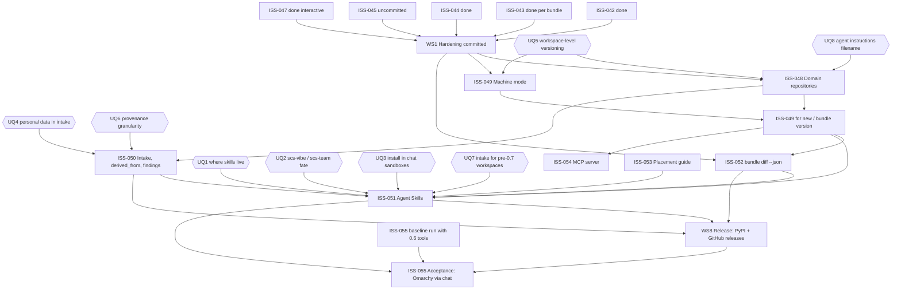

# Survey: Status and dependencies

Surveyed 2026-10-25, worktree `/Users/timmc/Projects/work/structured-context-spec-0.7`, branch
`0.7-dev` at `f1c9d11` (1 commit ahead of `origin/0.7-dev`). Descriptive only. Inferences are
marked **(inference)**.

## Scope read

- `rfcs/RFC-0002-agent-mediated-scs.md`: Summary, Reference-level sections 1-12, Schema Changes,
  Validation Rules, Unresolved Questions, Appendix (Implementation Notes, Migration Guide), plus
  the uncommitted diff to it.
- `ROADMAP.md` (10 workstreams), `ISSUES.md` ISS-042..055 (lines 845-990), `CLAUDE.md`.
- Git: `git log origin/main..0.7-dev`, `git show --stat 43bc0dd f1c9d11 9a80886`, `git status`,
  `git diff` (all 16 modified files), the 3 untracked files, tags, branches, worktrees.
- Infrastructure: `.github/workflows/{tools-ci,deploy-docs}.yml`, both `pyproject.toml`,
  `mkdocs.yml`, package `__init__.py` files, `plugins/` layout.
- Live checks: `gh run list -b 0.7-dev`, `gh release list`, `gh pr list`, PyPI JSON API.
- Test runs on copies in the scratchpad (repo untouched): working tree and `HEAD` (via
  `git archive`), Python 3.12, plus ruff/black/mypy/`sync_schemas.py --check` on the working
  tree.

Note: local `main` (`7691b0f`) is stale against `origin/main` (`fd00722`), so
`git log main..0.7-dev` overstates the branch; the true set is `git log origin/main..0.7-dev`:

| Commit | Content |
|---|---|
| `9a80886` | Start 0.7-dev: CI runs on `0.7-dev`, CLAUDE.md, ISSUES.md header |
| `e85b8af` | ROADMAP: 0.7.0 replaces 0.5.0 roadmap |
| `2413716` | Merge `origin/main` (README PR #26) |
| `43bc0dd` | Hardening batch: ISS-042, 043, 044, 047 (+ `docs/MIGRATION-0.7.0.md` started) |
| `f1c9d11` | `spec/0.7/` copied from `spec/0.6/`, headers bumped (not pushed) |

## Issue status

| Issue | Title | Status | Evidence |
|---|---|---|---|
| ISS-042 | `scs --version` reports 0.5.0 | **Done (committed)** | `43bc0dd`: `tools/cli/scs_tools/__init__.py` reads `importlib.metadata`; test in `tools/cli/tests/test_scs_tools.py`; CI green on `43bc0dd` (run 40216848443) |
| ISS-043 | Version manifests/tags collide | **Done per bundle (committed); workspace qualification deferred to ISS-048** | `43bc0dd`: manifests `<name>-v<version>-MANIFEST.yaml`, tags `<name>-v<version>`, existing tag refused up front, `distribution` from git. ISSUES.md: "Workspace qualification of tags is ISS-048". RFC Impl. Notes step 1 asks for workspace- *and* name-qualified tags in hardening, so step 1 is not fully met by 043 alone |
| ISS-044 | cdmo templates "Profile: Project only" | **Done (committed)** | `43bc0dd`: line removed from 48 templates; test `test_cdmo_domain_scds_carry_no_profile_note` |
| ISS-045 | Versioned bundles not verifiably immutable | **In progress: implemented, tested, uncommitted** | Uncommitted: new `scs_validator/digest.py` (230 lines), `tests/test_digest.py` (10 tests), changes to `bundle_validator.py`, `validate.py`, `resolver.py`, `bundle-rules.yaml`, `compiler.py`, `bundle.py`, `test_compile.py` (+5 tests), runtime schema (both copies), `spec/0.7/{bundle-format,runtime-artifact}.md`, two regenerated example artifacts, MIGRATION rows. ISSUES.md status flipped to done in the working tree only. All tests and lint pass on the working tree (see Engineering) |
| ISS-046 | Accept RFC 0002 | **Done** | PR #25 merged 2026-10-25 (`4d8bb3e`, on `origin/main`) |
| ISS-047 | No approver from `git config` | **Done for interactive mode (committed); machine-mode suggestion deferred to ISS-049** | `43bc0dd`: `bundle.py` prompts (`click.prompt`, line ~329), blank aborts; MIGRATION row. ISSUES.md: "git suggestion for machine mode comes with ISS-049" |
| ISS-048 | Domain repositories | **Not started** | No `domain/`/`projects/`/`AGENTS.md`/`personal` profile in `tools/cli/scs_tools/commands/new.py`; ISSUES.md "open". Scope grew in the uncommitted RFC amendment (reserved dirs/bundle names) but ISS-048 text not updated |
| ISS-049 | Machine mode `--json`/`--dry-run` | **Not started** | No `--json`/`--dry-run` in `tools/cli/scs_tools`; 10 `click.prompt`/`click.confirm` calls remain. Only `scs-validate --output json` and `scs compile --output` pre-exist |
| ISS-050 | Intake, `derived_from`, review findings | **Not started** | No `schema/intake.schema.json` (`schema/` holds bundles, checkpoint, domain, runtime, scd); no `derived_from` in schema or validator |
| ISS-051 | Agent Skills | **Not started** | No skills directory for 0.7. Legacy skills exist in `plugins/scs-vibe/skills/` (init, validate, explain) and `plugins/scs-team/skills/` (init, draft, validate, status, use, add, version) |
| ISS-052 | `scs bundle diff` | **Not started** | No `diff` subcommand in `commands/bundle.py` |
| ISS-053 | Placement guide | **Not started** | No placement doc under `docs/` |
| ISS-054 | Local MCP server | **Not started** (lowest priority by design) | Nothing in tree |
| ISS-055 | Acceptance: Omarchy through chat | **Not started** | Nothing in tree; baseline run with 0.6 tools not recorded |
| (WS 8) | Release engineering | **Not started** | PyPI live check 2026-10-25: `scs-tools` only 0.1.0; `scs-validator` 404. `gh release list` empty. Both pyprojects still `version = "0.6.0"` |

## Uncommitted work

`git diff --stat`: 16 files, +403/-44, plus 3 untracked.

| File | Issue | Looks complete? |
|---|---|---|
| `tools/scd-validator/src/scs_validator/digest.py` (untracked) | ISS-045 | Yes: canonical JSON, `content_digest`, manifest lookup (new and legacy names), `verify_tree` with `mismatch`/`unrecorded` statuses |
| `tools/scd-validator/tests/test_digest.py` (untracked) | ISS-045 | Yes, 10 tests, pass |
| `tools/scd-validator/src/scs_validator/bundle_validator.py` | ISS-045 | Yes: `validate_digests` (mismatch = error in every mode, unrecorded = warning) |
| `tools/scd-validator/src/scs_validator/commands/validate.py` | ISS-045 | Yes: runs `validate_digests` after `validate_tree` |
| `tools/scd-validator/src/scs_validator/resolver.py` | ISS-045 | Yes: `BundleTree.index` added |
| `tools/scd-validator/src/scs_validator/rules/v0.6.0/bundle-rules.yaml` | ISS-045 | Yes: two messages. Added to the `v0.6.0` rules dir; there is no `v0.7.0` rules dir **(observation, not necessarily a defect)** |
| `tools/scd-validator/src/scs_validator/schemas/runtime/runtime-artifact-schema.json` | ISS-045 | Yes, matches repo-root copy (`sync_schemas.py --check` clean) |
| `schema/runtime/runtime-artifact-schema.json` | ISS-045 | Yes: `scs_runtime` enum `0.6`/`0.7`, `source_digest` pattern |
| `tools/cli/scs_tools/commands/bundle.py` | ISS-045 | Yes: digest + `content_inputs` in manifest; truthful `validation_passed`/`approval_status`; now hard-requires scs-validator |
| `tools/cli/scs_tools/compiler.py` | ISS-045 | Yes: `RUNTIME_FORMAT = "0.7"`, verify before compile, no override, `source_digest` emitted |
| `tools/cli/tests/test_compile.py` | ISS-045 | Yes: 5 new tests (record/carry digest, edited SCD refused, formatting-only edit ok, `--no-validate` truthful, legacy manifest warns) |
| `examples/two-tier-governance/compiled/*.yaml` (2) | ISS-045 | Yes: regenerated with `scs_runtime: '0.7'` + `source_digest` |
| `spec/0.7/bundle-format.md` | ISS-045 | Yes: §7.3 extended, new §7.6 Content Digest (+82 lines), "What changed in 0.7.0" |
| `spec/0.7/runtime-artifact.md` | ISS-045 | Yes: `source_digest` field, compile step 4 verification |
| `docs/MIGRATION-0.7.0.md` | ISS-045 | Yes: 5 table rows, notes 3-5 |
| `ISSUES.md` | ISS-045 | Yes: status to done + "Done:" paragraph |
| `rfcs/RFC-0002-agent-mediated-scs.md` | **Not an issue in ISS-042..055**: RFC amendment (reserved `plan/`, `test-plan/`, `qa/` directories and bundle names), work lands in ISS-048 | Text looks complete; ISS-048 description and ROADMAP not updated to match **(gap)** |
| `rfcs/0.8.DRAFT-plan-development.md` (untracked) | None (0.8 draft; the remainder of the cut-back amendment) | Draft by its own header |

Summary: the hardening batch is code-complete in the working tree; what remains is a commit
(ISS-045 + its spec/doc changes) and a separate commit for the RFC amendment and 0.8 draft
**(inference: they are logically separate changes)**. `f1c9d11` is also unpushed.

## Dependency graph and critical path

Edges are "must finish (or be decided) before". Evidence: RFC Implementation Notes order;
RFC §2 (skills call the engine in machine mode); §3 (envelope, approver suggestion); §4 (intake
starts by establishing the Domain repository); §6 (dry-run confirmation, change summary,
placement advice); §9 (tags/manifests); ISS-051 text; ROADMAP WS 8 (PyPI for hosted sandboxes).

Notes on edges:

- `ISS-050 -> ISS-048` is soft: the schema and validator rules can be written first, but
  `intake.yaml` lives in a workspace under the Domain repository layout (§9), and repository
  validation must find it **(inference)**.
- `ISS-049` splits: the envelope, `validate`, `compile`, and `add` can start right after
  hardening; `new` and `bundle version` depend on ISS-048's layout and on UQ5 **(inference)**.
- `ISS-052 -> ISS-051` is SHOULD-level (§6 item 6); skills could ship without diff, weaker.
- `ISS-053 -> ISS-051` is SHOULD-level (§6 item 8, §10).
- `REL -> ISS-055` holds when the acceptance run uses a hosted chat client whose sandbox
  installs from PyPI (UQ3). A local client with a clone would not need it **(inference)**.

**Critical path (inference):** commit hardening -> decide UQ5 (+UQ8) -> ISS-048 -> ISS-049
(`new`, `bundle version`) -> ISS-051 skills (needs UQ1-3, UQ7; joined by ISS-050, ISS-052,
ISS-053) -> WS8 PyPI publish -> ISS-055. ISS-051 is the convergence point; anything feeding it
late delays acceptance.

## Parallelizable work

| Can run now / in parallel | Depends only on | Notes |
|---|---|---|
| Commit ISS-045 + RFC amendment | nothing | Unblocks everything below |
| ISS-053 placement guide | nothing | Pure docs; needs live checks of each vendor's docs |
| ISS-055 baseline run (0.6 tools) | nothing | Baseline half of the acceptance test |
| ISS-049 envelope + `validate`/`compile`/`add` `--json` | hardening | Independent of repo layout |
| ISS-050 schema, `derived_from`, validator rules | UQ4, UQ6 | Can proceed alongside ISS-048 |
| ISS-052 diff core | hardening (named manifests, `content_inputs`) | `--json` output joins ISS-049 envelope later |
| WS8 prep: version bump plumbing, TestPyPI dry run, PyPI name/ownership check | nothing | Also tests UQ3 early **(inference)** |
| UQ3 sandbox install testing | a published (Test)PyPI package | Answers whether skills must bundle an engine |
| ISS-054 MCP | ISS-049 | Deferred by design until demand |

Must be serial: ISS-048 before ISS-049 for `new`; ISS-049 before skills; skills before
acceptance.

## Blocking decisions

| Unresolved question | Blocks | Evidence / coupling |
|---|---|---|
| UQ1 Where the skills live | ISS-051 layout and packaging; WS8 if separate repo (own release cadence); CI scope | RFC UQ1; ISSUES ISS-051 "settle first" |
| UQ2 Fate of `scs-vibe`/`scs-team` | ISS-051 (reuse vs replace 10 existing SKILL.md files in `plugins/`); docs | `plugins/*/skills/` exist today |
| UQ3 Install inside chat clients | ISS-051 (bundle a self-contained engine?), WS8 timing, ISS-055 | ROADMAP WS8; PyPI has no usable package |
| UQ4 Personal data in intake record | ISS-050 schema (role-only attribution), ISS-051 intake skill | RFC §4 |
| UQ5 Workspace-level versioning ("Decide before the engine work") | ISS-048 tags/manifests; ISS-049 `bundle version` shape; ISS-052 (what a "version" is); ISS-051 version skill; **and already-landed ISS-043/045 code** | `digest.py` `version_manifest_names()` and `find_version_manifest()` assume one manifest per bundle beside it; `spec/0.7/bundle-format.md` line ~564 now normatively names `<bundle-name>-v<version>-MANIFEST.yaml`. Choosing one-manifest-per-workspace would rework committed/uncommitted code and spec text |
| UQ6 Provenance granularity | ISS-050 schema (`derived_from` on SCD-level `provenance` too?) | RFC §5 |
| UQ7 Intake for pre-0.7 workspaces | ISS-051 intake skill; migration guide; ISS-055 if Omarchy baseline workspace is reused | RFC §4 |
| UQ8 Agent instructions filename | ISS-048 scaffold (`AGENTS.md` + pointer files) | RFC §9 |

## Engineering infrastructure

**CI** (`.github/workflows/tools-ci.yml`, ISS-013/036/035):

- Triggers: push to `main` and `0.7-dev`; any PR. Path-filtered to `tools/**`, `schema/**`,
  `meta/**`, `examples/**`, the workflow file. Changes to `spec/`, `docs/`, `rfcs/` do not run CI.
- `test`: matrix Python 3.11/3.12; `pip install -e tools/scd-validator -e tools/cli pytest
  pytest-cov`; `pytest tests` in each package.
- `lint`: Python 3.12; ruff (E, F, W, I) on both packages; black `--check` on both; **mypy on
  scs-validator only** (`disallow_untyped_defs`); scs-tools has no mypy config.
- `wheel-smoke`: builds both wheels, installs non-editable, scaffolds/validates/versions outside
  the tree (healthcare and mca). It installs both wheels, so the ISS-045 hard dependency of
  `scs bundle version` on scs-validator is satisfied there **(inference, not run)**.
- Latest runs on `0.7-dev` (3) all success; last is `43bc0dd`.
- `.github/workflows/deploy-docs.yml`: MkDocs Material to GitHub Pages on push to `main` for
  `docs/**`/`mkdocs.yml`.

**Local test results (this survey):**

| Tree | scs-validator | scs-tools | Lint |
|---|---|---|---|
| `HEAD` (`f1c9d11`) | 194 passed | 147 passed | not run |
| Working tree | 204 passed, 72% coverage | 152 passed | ruff clean; black clean (both); mypy clean (16 files); `sync_schemas.py --check` clean |

**Packaging:**

| | `tools/cli` | `tools/scd-validator` |
|---|---|---|
| Name | `scs-tools` | `scs-validator` |
| Version | `0.6.0` (static) | `0.6.0` (static) |
| Layout | flat, explicit package list | `src/` |
| Entry point | `scs = scs_tools.cli:cli` | `scs-validate = scs_validator.commands.validate:validate` |
| `__version__` | from package metadata (ISS-042) | hardcoded `"0.6.0"` in `__init__.py`, used in `scs-validate` reports |
| Extras | `validator = ["scs-validator>=0.6.0"]` | `dev` (pytest, black, mypy, ruff, stubs) |
| Build | setuptools; `setuptools_scm` in build-requires but unused | setuptools>=68 |
| URLs | `tim-mccrimmon/structured-context-spec` | `tim-mccrimmon/scs-spec` (differs) |
| Package data | `templates/**/*` | rules, vendored schemas, vendored meta bundle |

**Release engineering state:** PyPI holds `scs-tools` 0.1.0 only and no `scs-validator`
(verified live 2026-10-25). README installs 0.6.0 from GitHub tag subdirectories. No GitHub
releases exist (`gh release list` empty). ISS-014 deferred the PyPI upload in 0.5.0. No publish
workflow exists in `.github/workflows/`.

**Docs site:** `mkdocs.yml` nav is 0.3-era (concern docs, `MIGRATION-0.3.md`); it omits
`MIGRATION-0.5.0/0.6.0/0.7.0.md`, `bundle-lifecycle.md`, and the spec. Last nav change `7691b0f`
(2026-09-27). Deploys only from `main`. The placement guide (ISS-053) has no nav slot yet.

**Branching and tags:** pattern is `0.x-dev` branches (0.5-dev, 0.6-dev, 0.7-dev), each with a
worktree (`structured-context-spec-0.6`, `-0.7`), merged to `main` by PR (PRs #23, #25); release
tags `v0.3.0`, `v0.5.0`, `v0.6.0`, with `v0.6.0` on the main merge commit `3493015`. Release
notes as root files (`RELEASE-NOTES-0.6.0.md`) plus `docs/MIGRATION-<version>.md`. CI branch list
is edited per dev branch (`9a80886`). CONTRIBUTING.md says feature branches from `main`, which
differs from the `0.x-dev` practice **(observation)**.

## Risks

- **UQ5 is "decide before the engine work", but per-bundle naming is already in code and spec.**
  ISS-043 (committed) and ISS-045 (uncommitted `digest.py`, `spec/0.7/bundle-format.md` §7.6)
  bake in one manifest per bundle. A workspace-level choice reworks both.
- **`scs bundle version` now hard-requires scs-validator** (uncommitted `bundle.py`), but
  scs-validator is only an optional extra of scs-tools and is not on PyPI, so the error's
  remedy `pip install 'scs-tools[validator]'` fails for a PyPI user until WS8 lands.
- **Same staleness bug as ISS-042 in scs-validator:** `__version__ = "0.6.0"` is hardcoded and
  feeds `scs-validate` JSON/text reports; it will report 0.6.0 in 0.7.0 unless bumped or read
  from metadata.
- **Large uncommitted change** (16 files + 3 untracked) on a branch also 1 commit unpushed;
  ISS-045 and the RFC amendment are mixed in one working tree.
- **ISS-048 scope drift:** RFC amendment adds reserved directories/bundle names and validator
  rules; ISS-048 and ROADMAP WS2 text do not mention them.
- **Hardening step 1 not fully closed per the RFC:** workspace-qualified tags were deferred from
  ISS-043 to ISS-048; ISS-047's machine-mode suggestion deferred to ISS-049.
- **Interactive prompts** (10 `click.prompt`/`confirm` calls) block agent use until ISS-049.
- **Hosted-sandbox install (UQ3) is untested** and gates skills design and acceptance; it can
  only be tested once something is published (Test)PyPI.
- **Docs site is stale** and deploys only from `main`; 0.7 docs (placement guide, migration)
  will not appear until a release merge and nav update.
- **CI gaps:** no mypy for scs-tools; `spec/`/`docs/` changes run no checks; no publish job.
- **RFC body links `spec/0.6/`** while normative 0.7 text now lives in `spec/0.7/` **(minor)**.
